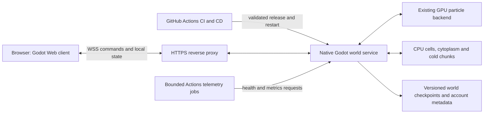

# Multiplayer and persistent-world proposal

Status: proposal, October 13, 2026. Game changes and service deployment have not been implemented.
Source baseline: Revision 43, samzapo/chemistry-sandbox at aa80d7b6de9d5359529bb3197a40da85e95b8e78.
Scope: private samzapo/primordia only. Host telemetry was expressly authorized by the owner.

## Recommended architecture

Keep one authoritative native Godot simulation on samzapo-desktop. Preserve the existing C++ kernels, Vulkan/RenderingDevice compute shaders, particle chemistry, cold CPU regions and GDScript cell physiology. Add a server entry point, multiplayer sessions, durable world checkpoints and a compact replication boundary. Browsers render received state and submit paid anatomy/configuration commands.

Begin with one bounded shared pond and a small, measured player limit. Give each player a lineage; retain autonomous anatomical steering and pheromone-only sensing. Add larger worlds and sharding only after sustained performance is established.

GitHub Actions builds, validates and deploys a release. A separately managed systemd service runs the world continuously after the job finishes. The browser connects through HTTPS/WSS to that service. World storage remains outside Actions checkout and release directories.

This retains the GPU simulation on the server. It does not make the current whole application a zero-change browser export: server orchestration, GPU publication/checkpoint interfaces, player ownership and some presentation adapters must change.

## Verified target machine

A bounded, read-only Actions job ran successfully on samzapo-desktop:
https://github.com/samzapo/primordia/actions/runs/38417854841
Workflow revision: 794a92bddfa3c7df5557e9e51383abf344b09ff6.

Three samples were collected five seconds apart on October 13, 2026:

| Property | Observation |
| --- | --- |
| OS | Linux x86_64, kernel 6.8.0-139-generic |
| CPU | AMD Ryzen Threadripper 2990WX, 32 cores / 64 logical CPUs |
| RAM | 62.75 GiB total; approximately 47.6–47.7 GiB available |
| GPU | NVIDIA GeForce RTX 3090, 24 GiB VRAM; driver 595.84 |
| Sampled GPU load | 0%; about 1.51 GiB VRAM in use; 39–40 C |
| Workspace filesystem | Approximately 347 GiB free |
| Sampled compiler/build processes | None among the bounded process-name list |
| Runner display environment | DISPLAY, WAYLAND_DISPLAY and XDG_RUNTIME_DIR absent |
| Tools on PATH | Vulkan tooling, NVIDIA tooling, CMake, Ninja and systemctl present; Godot absent |

Absence from PATH does not establish absence of the Steam Godot installation. These are host capability/load samples, not game benchmarks. Network upload capacity, wired route, actual RenderingDevice initialization, simulation/wall rate, readback/checkpoint cost and overnight stability remain unmeasured.

The workflow checks repository and runner identity, requests read-only repository permissions, has a five-minute timeout, does not check out source or launch the game, and removes its unique scratch directory. Existing Git SSH authentication published the branch after the OAuth Git credential rejected workflow publication for missing workflow scope. Credentials and host settings were not changed.

## HTML5 rendering options

Godot's current stable web export targets WebGL 2 with the Compatibility renderer; it does not provide the RenderingDevice compute path used by this project. Native GDExtensions must be separately compiled for the web. These constraints are documented in [Godot web export](https://docs.godotengine.org/en/stable/tutorials/export/exporting_for_web.html) and [compute shader support](https://docs.godotengine.org/en/stable/tutorials/shaders/compute_shaders.html).

| Option | Existing GPU simulation | Presentation cost | Recommendation |
| --- | --- | --- | --- |
| Godot Web client with server state | Preserved natively on the server | Reuse much of the procedural artwork, cell drawings and UI; replace direct simulation/native-render access with received state | First choice |
| Custom HTML/WebGL client | Preserved natively on the server | Rebuild presentation and editor; potentially smaller client and finer browser integration | Later alternative if Godot Web proves limiting |
| WebRTC video streaming | Preserved on the server, together with native rendering | Per-player camera rendering, encoding, audio and bandwidth; native pixels reach browser | Useful fidelity prototype or fallback |
| Run current compute backend in each browser | Requires a port or different engine/backend support | Does not provide authoritative persistence by itself | Avoid as the initial path |

The project already defaults its presentation to Compatibility. That makes reuse plausible, but it is not proof that every shader, native MultiMesh helper or audio path will work unchanged in a web build.

The progressive techno synthesis also needs a deliberate web path. Keep synthesis local to each client using Godot streaming audio, or a narrowly scoped Web Audio adapter if needed; publish musical event/source state rather than server-generated stereo mixes. Godot's default web sample mode excludes procedural audio, whereas stream mode restores its audio features with latency/threading tradeoffs. Verify client latency, autoplay activation and any required cross-origin isolation headers. See the same web-export documentation.

## GPU service startup is the first gate

Current resident_particles.gd explicitly rejects headless/Compatibility and uses RenderingServer.get_rendering_device() on the render thread. Godot documents that both global and local RenderingDevice creation return null under ordinary headless mode: [RenderingServer](https://docs.godotengine.org/en/stable/classes/class_renderingserver.html).

The first server deployment should preserve the existing main-device path using a minimal native Godot scene and a managed, real-GPU display context. It must survive runner job completion, user logout and boot. Verify the actual RTX 3090 driver and compute dispatch; a software virtual display is not equivalent evidence.

This is an operational prototype gate, not a claim that the display context is already configured. Moving the kernels into a standalone Vulkan service could remove the display dependency later, but would require significant host/orchestration work and would no longer retain the complete backend unchanged.

Keep the CPU fallback as an explicit recovery option. Record and surface fallback rather than reporting CPU execution as healthy GPU operation. Preserve the world rather than reseeding it when changing backend.

## Make the simulation independent of sessions

The present code has one player, one camera, one evolution object and global edit/terminal pauses. evolution.gd ends the expedition at 810 seconds. simulation.gd and resident_ecology.gd stop for terminal/build states. lineage_archive.gd saves local history, not a full world.

Introduce a WorldHost with a fixed-step, monotonic simulation clock and a collection of PlayerSessions. Account, lineage, selected cell, camera, editor context and connection are session state; the world advances with zero sessions.

Replace the expedition's global ending with persistent world seasons/environmental events and optional per-lineage objectives. Death or mission completion must not stop the pond. Time scale remains explicit; target one simulated second per wall second before advertising daily evolution at real-time speed.

Current GPU residency follows one camera. Extend it to server-owned regions with one authoritative owner per packet, bounded GPU admission/eviction and time-correct CPU background work. Detail scheduling should follow biological activity and a documented server policy rather than whether someone opens a tab. Network interest regions determine what is transmitted. Test observation/camera invariance and region-boundary conservation independently.

Multiple windows must not duplicate the particles they share. Avoid running one independent world/pool per player. Preserve transfer escrow, timestamps, source metadata, family safety and exactly-once receipts.

## Multiplayer interaction and offline behavior

Recommended first model: each account owns a lineage in the same pond and can edit its currently selected eligible cell. Ownership permissions are separate from biochemical family identity. Players still influence behavior through anatomy; there are no direct movement inputs or new remote prey sensing.

While disconnected, living cells continue autonomous sensing, feeding, cytoplasmic reactions, secretion and physical contact under the same rules. Reproduction, where automated, must use funded division and actual metabolite partitioning. Return to a living funded descendant or the lineage record after death; do not rewind the world. Existing prepaid dormant successors can provide a deliberate reserve option without freezing other life.

Long-term lineage viability is a design question, not an established property of the current short expedition. The first version should not promise that a lineage survives a day. Keep gameplay balance tests disabled; uptime/transport/correctness soaks must not require particular survival, kill rates or population outcomes.

Global paused editing cannot carry over to a shared world. The proposed multiplayer editor shows a local preview and applies individually validated commands at tick boundaries while real physiology continues. Validate ownership, current cell identity/revision, available tissue/AP and geometry; reject stale or unaffordable edits. Opening a panel grants no temporary shelter. Preserve fixed-size paid organs, no Undo and existing chemistry-template restrictions. This is a proposed multiplayer behavior change; single-player editing can retain its pause.

Use invite-based accounts for the first private deployment. Commands include session identity, command sequence and expected entity revision; retries are idempotent. Server validation is authoritative. Persist ownership and reconnect state, and rate-limit large view/inspection requests.

All chemical transport stays particle-mediated, including the cytoplasm. Networking publishes render state and sends permitted commands; it never implements chemical stocks, teleports graph products or credits resource totals.

## Network publication

Start with secure WebSockets. This suits anatomy/configuration interactions and is supported by Godot native and web clients. Add WebRTC data channels only if measured latency or loss makes reliable ordered snapshots a problem. WebRTC native integration and signaling introduce additional work. See [Godot WebSockets](https://docs.godotengine.org/en/4.7/tutorials/networking/websocket.html) and [WebRTC](https://docs.godotengine.org/en/4.7/tutorials/networking/webrtc.html).

Transmit bounded spatial subscriptions rather than the entire world:

- Stable entity IDs and explicit create/update/delete events.
- Cell poses, membrane samples and changed anatomy.
- Nearby exterior particles: ID, pose/orientation, species, amount and selected visual flags.
- Detailed intracellular packets and vacuoles for the selected/inspected cell; bounded detail for other nearby cells.
- Light/current/acidity render data at a lower publication frequency.
- Transient reaction/audio events with sequences, preventing replay on reconnect.

Render smoothly through interpolation between server snapshots, with immediate local camera/UI response. Start by measuring 10–20 publications per second and a 60 Hz client drawing target; neither is an established capacity result. Rendering interpolation never becomes authoritative chemistry.

Add a GPU gather/publication pass and bounded asynchronous readback staging for subscribed data. Deduplicate overlapping views and batch shared extraction. Do not call the diagnostic full-pool snapshot every frame. Checkpoints are a separate, infrequent operation.

Bandwidth matters: 7,000 packets x an illustrative 16-byte record x 20 updates/s is 2.24 MB/s, about 18 Mbit/s per player, before cells/protocol overhead. This is arithmetic, not measured network traffic. Use deltas, compact render-only quantization, per-client budgets and backpressure. A slow client may lose superseded visual snapshots; it cannot stall or alter simulation. Send a fresh coherent subscription snapshot after tab suspension or reconnect.

## Durable world storage and recovery

Use versioned binary checkpoint blobs plus a manifest and a small local metadata store. SQLite can hold account/ownership metadata and command audit/idempotency records; keep its transaction boundary consistent with the checkpoint manifest. It must be managed by one world writer on local storage. [SQLite WAL](https://sqlite.org/wal.html) is an implementation option, not a second simulation authority.

Initial target: a complete checkpoint every 30–60 seconds, plus graceful stop/deploy. Capture one consistent tick after draining GPU commits and resolving ownership transfers. Serialize:

- Hot GPU and cold CPU particles, intracellular particles, packet IDs/generations, immutable emission reports and absolute timestamps.
- Cells, membranes, anatomy, chemistry configurations, vacuoles, fuel and paid successor reserves.
- Fluid/acidity, environment phase, habitat seed/version and any mutable habitat state.
- RNG states/counters, reaction tick, allocation/identity counters, material inputs/losses and pending receipts/emission escrow.
- Lineages, account ownership, progression and the last represented command sequence.

Persist logical data, never Godot RIDs or process pointers. Existing snapshots/fallback export are useful starting points but do not constitute a complete save format.

Write immutable blobs with checksums, flush them, and atomically publish the manifest last. Retain known-valid generations and test recovery from interrupted writes. Initial crash guarantee is recovery to the last committed checkpoint, with up to the checkpoint interval of world progress lost; an input journal alone does not reconstruct GPU chemistry exactly. Define durable acknowledgement for important player edits before promising zero-loss purchases.

Record schema version, simulation build SHA and chemistry-catalog version. Validate migration against a copy before touching the live world. Roll back a release only when the checkpoint format is compatible, otherwise restore a separately retained compatible checkpoint with explicit progress loss.

A running server advances while players are absent. A powered-off machine cannot run GPU simulation. Initially resume from the last checkpoint after host downtime; any future catch-up must use bounded real reaction/transport steps and report catch-up lag, not one enormous dt or algebraic resource awards. A second host would be needed for meaningful host-failure continuity.

Production checkpoints are retained world state, distinct from disposable simulation replay/capture/test artifacts. Define retention and any backup destination explicitly; large transfers still require a verified wired route or the owner's Wi-Fi authorization. No bulk transfer was performed for this proposal.

## CI, CD and telemetry

Propose three workflows:

1. CI: script/native correctness and conservation checks, web export/build checks, GPU correctness/performance checks on the intended machine after confirming capacity. Keep every gameplay-balance gate disabled.
2. CD: trusted release revision only; build reproducible server/client packages, acquire a deployment lock, drain to a checkpoint, stage a release directory, atomically select it, restart the systemd world service, then verify tick advancement, GPU identity/backend and world identity. Revert only if data remains compatible.
3. Telemetry: bounded manual/scheduled health samples and deployment summaries. Include build/world ID, uptime, tick p50/p95/p99, simulated/wall time ratio, GPU wait/readback bytes, RAM/VRAM/thermal load, region/packet counts, network queues/bytes and checkpoint age/latency/errors.

Actions job lifetime is limited, including self-hosted jobs; it is not the lifetime of the server. See [Actions limits](https://docs.github.com/en/actions/reference/limits). systemd provides independent restarts and watchdogs: [systemd.service](https://github.com/systemd/systemd/blob/main/man/systemd.service.xml).

Use one deployment concurrency group and an on-host lock, so builds/telemetry cannot race world replacement. Avoid cancelling a running deployment halfway through a checkpoint transition. [Actions concurrency](https://docs.github.com/en/actions/how-tos/write-workflows/choose-when-workflows-run/control-workflow-concurrency).

Give the runner a distinct Primordia label when configuring deployment; its current name is not a scheduling label. Until then the telemetry workflow uses its verified current labels and fails immediately if RUNNER_NAME differs. Keep releases/state under Primordia-only paths and the service under a dedicated account. The service need not receive GitHub credentials or access unrelated projects.

Expose browser assets and WSS through an HTTPS reverse proxy, for example Caddy. Its documented [automatic HTTPS](https://caddyserver.com/docs/automatic-https) and [WebSocket-capable reverse proxy](https://caddyserver.com/docs/caddyfile/directives/reverse_proxy) fit this role. A domain and a verified inbound route or tunnel remain prerequisites; GitHub runner connectivity is outbound and does not prove browsers can reach the host.

Continuous metrics belong to the running service. Actions reports deployment health and periodic samples; scheduled Actions cannot be the sole outage detector because the target runner may be offline. Add an external health check later if reliable outage notification is required.

## Implementation order and acceptance

1. Prove GPU service operation on samzapo-desktop under the runner/service identity, without depending on an interactive login. Measure CPU/GPU load and tick cost; verify the actual wired route before substantial downloads.
2. Build WorldHost and checkpoint/restore. Verify zero-client advancement, exact accounting through restore, interrupted writes and graceful/crash recovery. Preserve the current mixed CPU/GPU backend.
3. Add two native network clients, per-lineage authorization and transactional editing. Check retries, stale commands, ownership and overlapping-region handoffs.
4. Export a rendering-only Godot Web client; verify procedural art, intracellular inspection, audio and reconnect. Measure compact GPU publication and bandwidth before fixing player limits.
5. Deploy a private small-player pond with serialized CD and telemetry. Run an overnight engineering soak and restart/restore exercises. Evaluate simulation/wall ratio, memory growth, bounded queues, finite chemistry and checkpoint reliability. Do not treat survival or population balance as acceptance criteria while the owner's hold remains active.

The main uncertainty is sustained simulation and publication throughput on the target machine, followed by unattended real-GPU initialization. The measured hardware is a reasonable development target, but it does not establish a player count, 60 FPS server throughput or a 24-hour stable persistent world.
